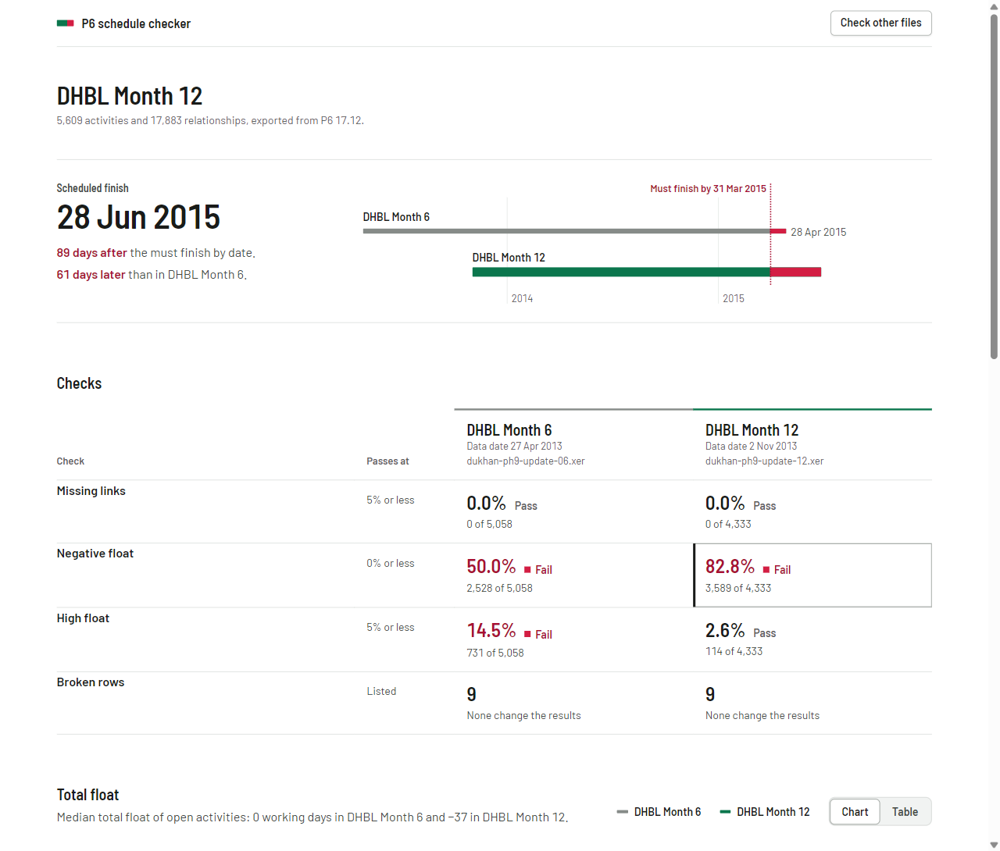
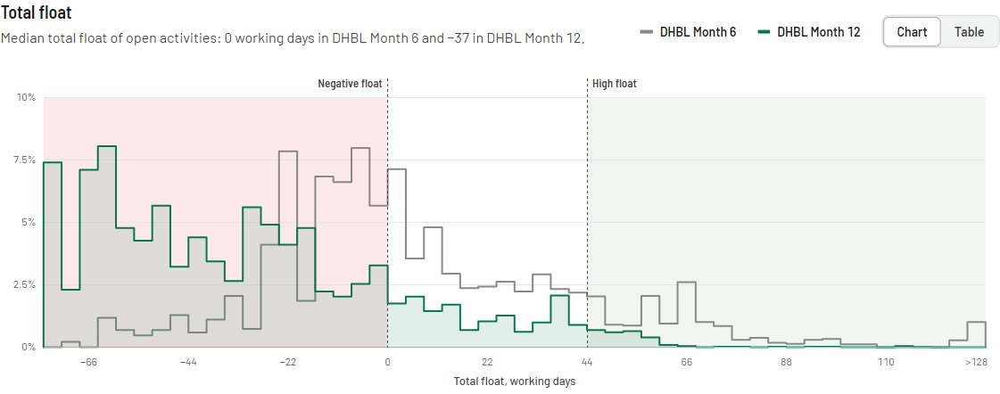

# P6 Schedule Checker

A web app for checking monthly Primavera P6 schedule updates. Upload this month's `.xer` export and last month's, and the page checks both and reports what changed between them.



## Features

- Runs three checks on open activities (not complete, leaving out level of effort and WBS summary activities), with the limits from the DCMA 14-point assessment:
  - Missing links: no predecessor or no successor. Passes at 5% or less.
  - Negative float: total float below zero. Passes at 0.
  - High float: more than 44 working days of total float. Passes at 5% or less.
- Click any result in the checks table to see the activities behind it, with their Activity IDs and line numbers in the file.
- Flags broken rows by line number and shows whether each one affects the results.
- Shows each update's scheduled finish against the project's must finish by date.
- Charts total float for up to three updates.
- Writes a short review of what changed between the two latest updates, which you can copy as text. Code writes every sentence from the computed counts.
- Stores uploads in Postgres. The page URL holds the file IDs, so you can share a link to the results.

## Example: Dukhan Housing Project

The sample files are the Month 6 and Month 12 updates of Dukhan Housing Project Phase IX, exported from P6 17.12, with about 5,600 activities each. [data/SOURCES.md](data/SOURCES.md) lists where they come from. I used two updates of the same project so the comparison has real changes to report.

|                  | Month 6             | Month 12            |
| ---------------- | ------------------- | ------------------- |
| Data date        | 27 Apr 2013         | 2 Nov 2013          |
| Open activities  | 5,058               | 4,333               |
| Missing links    | 0, pass             | 0, pass             |
| Negative float   | 2,528 (50.0%), fail | 3,589 (82.8%), fail |
| High float       | 731 (14.5%), fail   | 114 (2.6%), pass    |
| Scheduled finish | 28 Apr 2015         | 28 Jun 2015         |

From Month 6 to Month 12:

- The scheduled finish moved 61 days later, from 28 to 89 days past the must finish by date of 31 Mar 2015.
- 725 activities finished and 43 started.
- Of the 4,333 activities open in both updates, 4,286 lost float and 1,294 went from zero or positive float to negative.
- Relationships changed between 63 pairs of activities. In 59 of them, an FS relationship became FF.

High float passes in Month 12 because work finished and float fell. Of the 731 activities over 44 days in Month 6, 304 were complete by Month 12 and 316 had dropped to 44 days or less.

The median total float of open activities fell from 0 to −37 working days:



## Accuracy

- Float is the total float P6 stored in the file (`total_float_hr_cnt`). The checker does not reschedule the project.
- [tools/crosscheck_mpxj.py](tools/crosscheck_mpxj.py) recounts the three checks and the comparison counts with [MPXJ](https://www.mpxj.org/), an independent XER reader. Its counts match the app's for both files.
- The tests pin the Dukhan results. The server tests store both files in a real Postgres database and read them back.

## Assumptions

I would confirm these choices with a scheduler:

- A link to a completed activity counts as a link. Some teams expect open work to link to other open work.
- The comparison matches activities by Activity ID. If a team renumbers activities between updates, they show as removed and added.
- High float converts hours to days with each activity's own calendar. P6 can use one fixed hours-per-day setting, which gives different results on calendars that are not 8 hours a day. All 163 calendars in the Dukhan files are 8 hours.

## Running locally

You need Node 24 and Docker. The front end is React and TypeScript, the API is Node with Hono, and the data is stored in Postgres.

```sh
npm ci
docker compose up -d db
npm run dev:server   # API on port 3000
npm run dev          # page on port 5173
```

The tests use the same database:

```sh
npm test
```

To repeat the MPXJ cross-check, install Java and [uv](https://docs.astral.sh/uv/), set `JAVA_HOME`, and run:

```sh
uv run --no-project --with mpxj --with jpype1 python tools/crosscheck_mpxj.py data/dukhan-ph9-update-06.xer data/dukhan-ph9-update-12.xer
```

## Deployment

The live demo runs on Cloudflare. A Worker serves the page and forwards API requests to a Container built from the [Dockerfile](Dockerfile). Postgres runs on Neon.

```sh
npm --prefix cloudflare ci
npx --prefix cloudflare wrangler secret put DATABASE_URL
npm run deploy:cloudflare
```

[infra/template.yaml](infra/template.yaml) is a CloudFormation template for running the same image on AWS: ECS Express Mode on Fargate, RDS for PostgreSQL, the database password in Secrets Manager and an AWS WAF rate limit. `npm run deploy` builds the image, pushes it to ECR and deploys the stack. I haven't deployed this stack because I don't have AWS credits.
